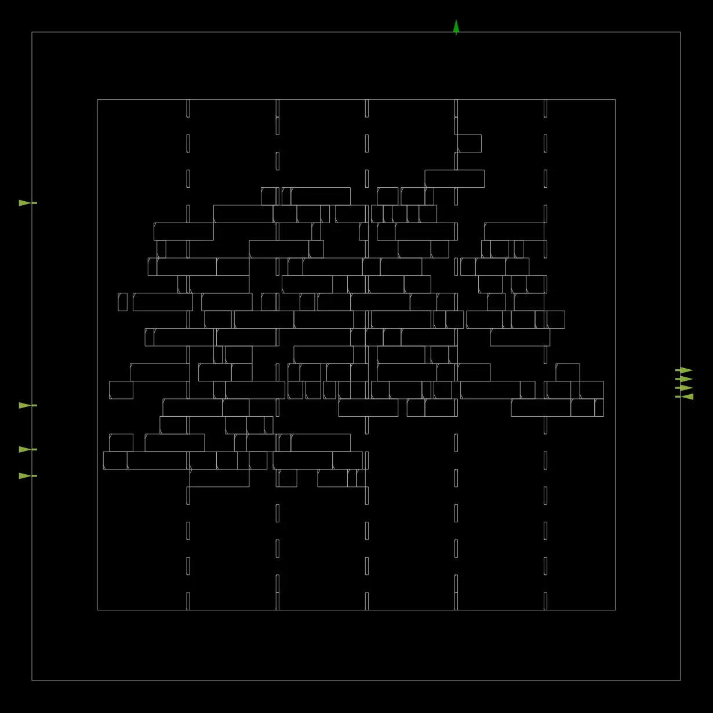
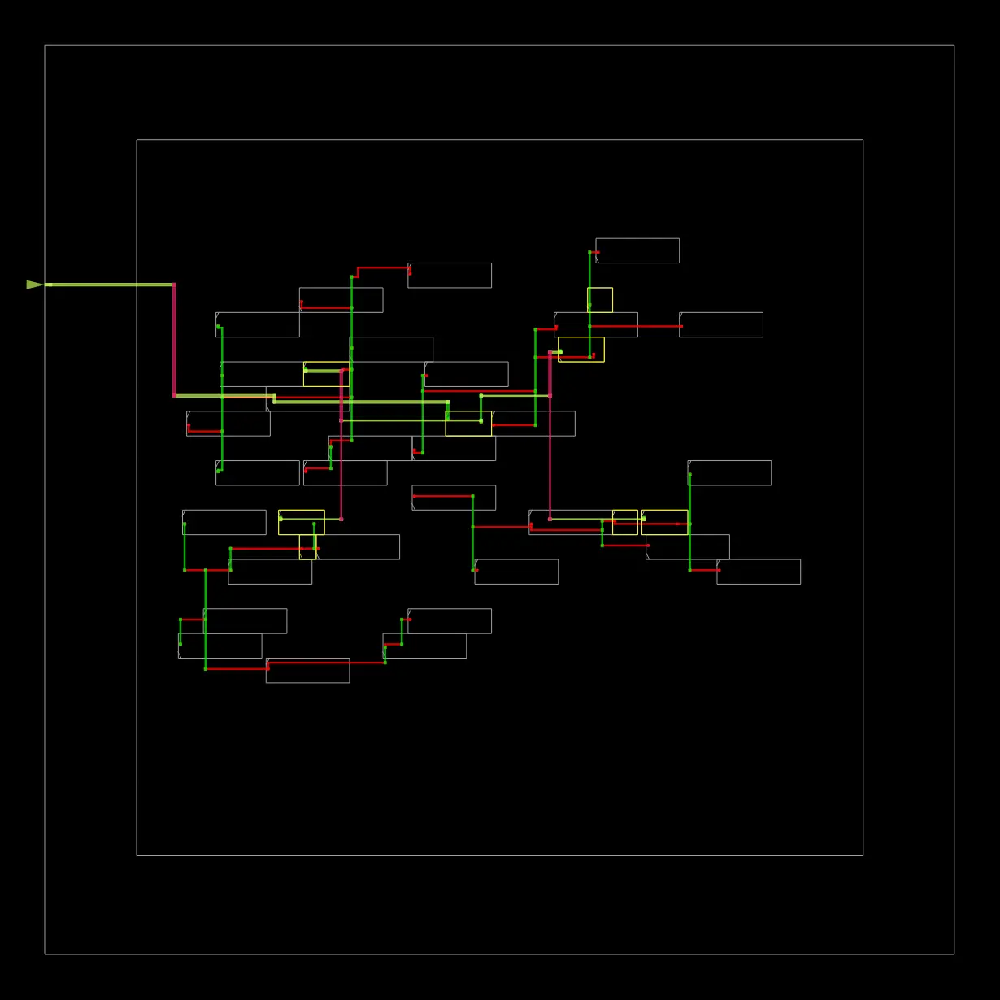
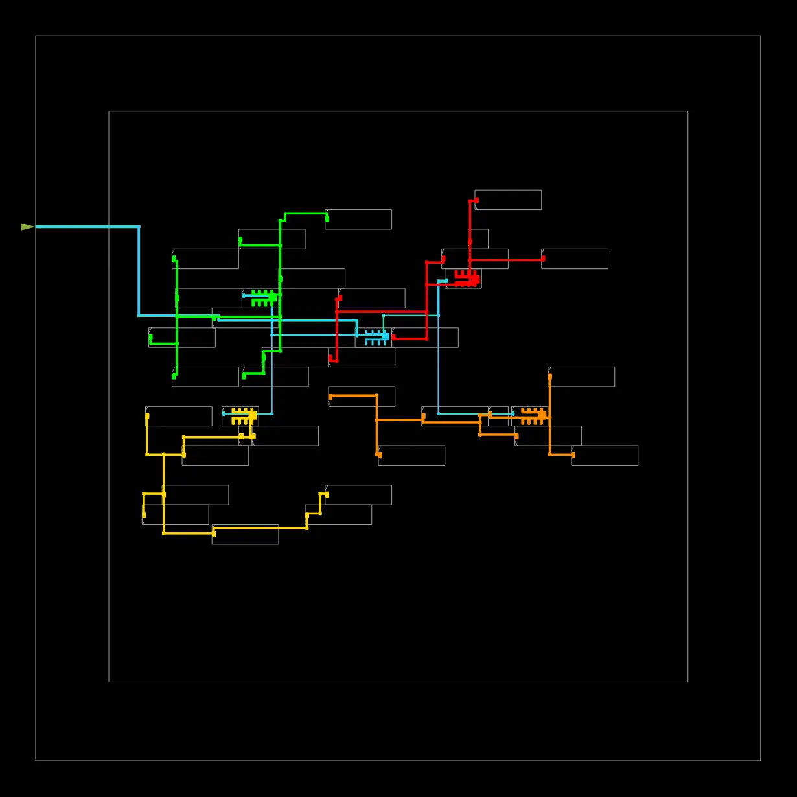
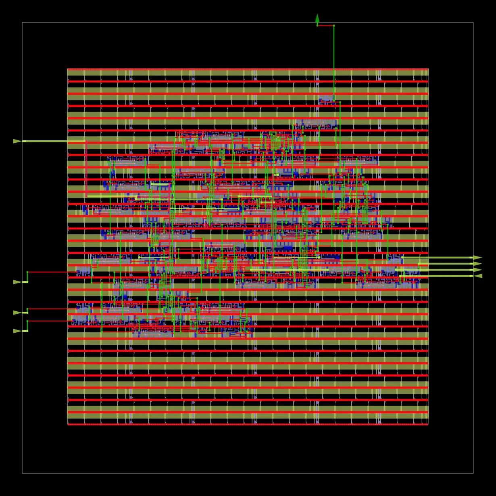
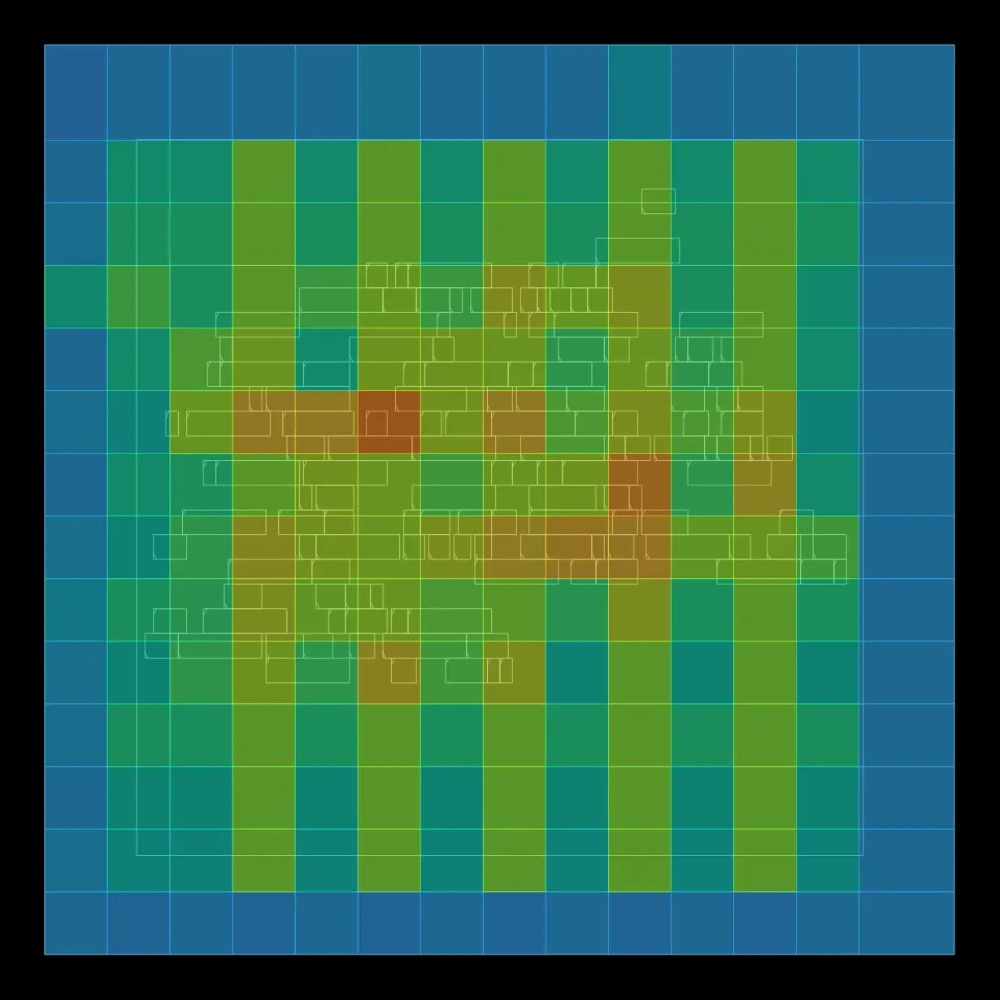
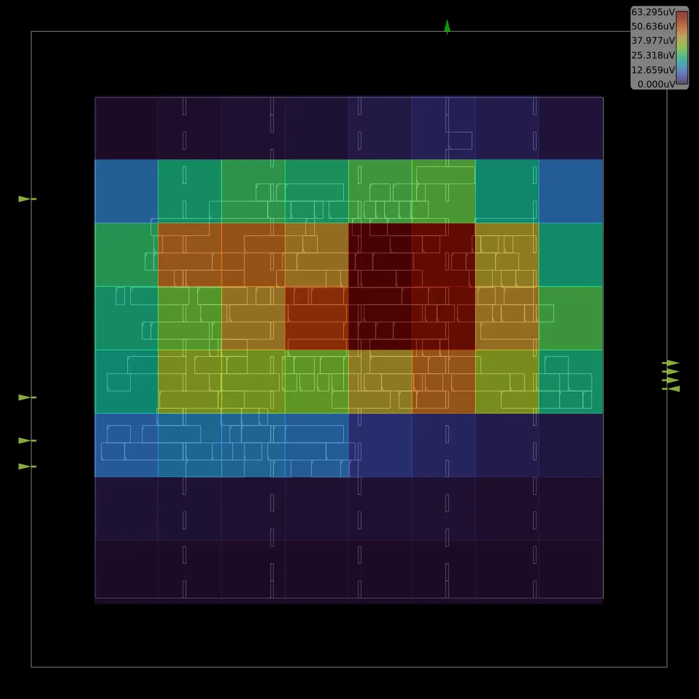
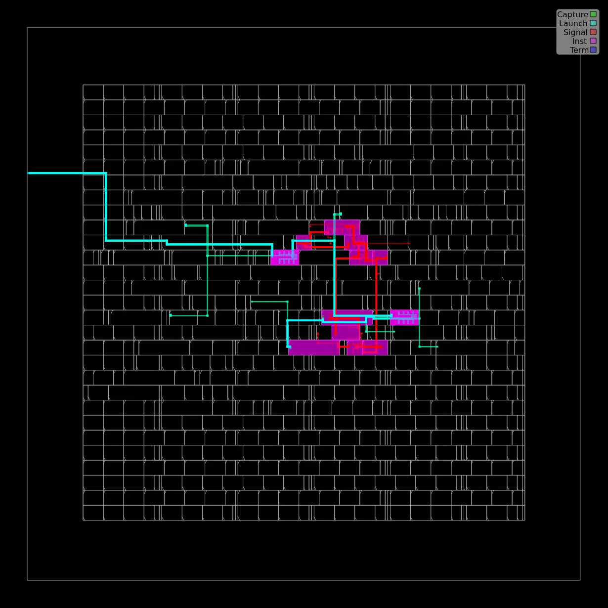
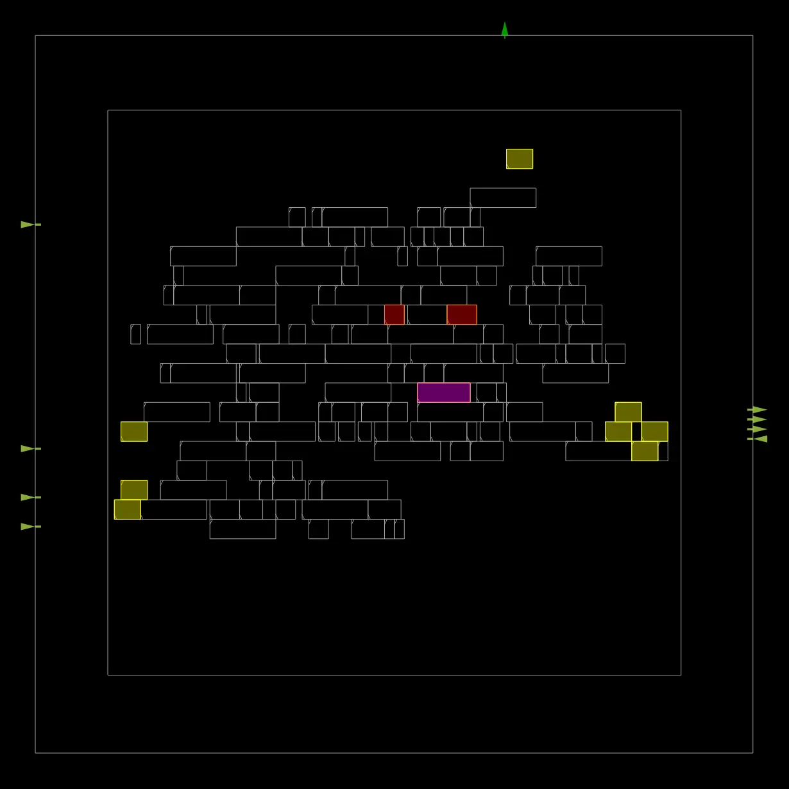

# 🌊 Flood Alert Controller — RTL to GDS

A Verilog-based Flood Alert Controller implemented using **OpenROAD Flow Scripts (ORFS)** and the **Sky130HD** technology platform.

## 📌 Project Overview

This project implements a digital flood alert controller that monitors water-level inputs and supports alert-level escalation with rate-of-rise detection. The design is taken through the RTL-to-GDS physical-design flow.

## ✨ Features

- Verilog RTL implementation
- Water-level monitoring and alert escalation
- Floorplanning and standard-cell placement
- Clock-tree synthesis (CTS)
- Global and detailed routing
- Physical-design visualization and report generation
- DRC and LVS verification

## 🛠️ Tools & Technologies

- **HDL:** Verilog
- **Physical Design:** OpenROAD Flow Scripts (ORFS)
- **Technology Platform:** Sky130HD
- **Layout Format:** GDSII

## 📁 Project Structure

```text
flood_alert/
├── rtl/
│   └── flood_alert.v
├── tb/
├── gls/
├── physical_design/
├── final_deliverables/
│   └── flood_alert.gds
├── docs/
│   └── images/
├── reports/
└── README.md
```

## 🖼️ Physical Design Flow — Visual Results

### 1. Floorplanning


### 2. Standard-Cell Placement




### 3. Clock-Tree Synthesis (CTS)





### 4. Routing




### 5. Congestion Analysis



### 6. IR-Drop Analysis



### 7. Timing Analysis





## 📊 Verification Results

| Check | Result |
|---|---|
| DRC | 0 reported violations |
| LVS | Netlists matched successfully |
| Hold Timing | No violations reported |
| Setup Timing | Not yet closed |

## ⏱️ Timing Summary

- **Clock Period:** 10 ns
- **Worst Negative Slack (WNS):** Approximately −2.70 ns
- **Total Negative Slack (TNS):** Approximately −24.25 ns
- **Setup Violations:** 15

> **Note:** The physical-design flow completed and generated a final GDSII layout. However, setup timing closure has not been achieved, so the design is not timing-clean for signoff.

## 📦 Final Deliverable

The generated layout is available at:

[`final_deliverables/flood_alert.gds`](final_deliverables/flood_alert.gds)

## 🚀 Future Improvements

- Optimize critical-path timing
- Add and run a dedicated RTL testbench
- Perform gate-level simulation
- Re-run timing analysis after optimization

---

**Project:** Flood Alert Controller  
**Flow:** RTL-to-GDS using OpenROAD  
**Platform:** Sky130HD
